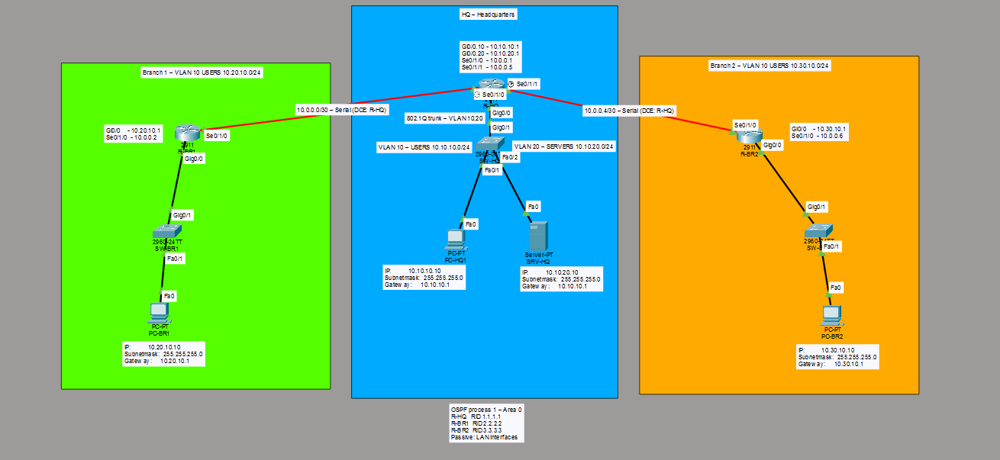

# Multi-Site Network Lab

## Overview
A multi-site company network built in Cisco Packet Tracer. A headquarters
and two branch offices are connected over serial WAN links, with
single-area OSPF providing dynamic routing between all sites.

This is the second project in my networking portfolio, following
[enterprise-network-lab](https://github.com/techby-niko/enterprise-network-lab).

## Topology
- 3 routers (Cisco 2911 with HWIC-2T serial modules)
- 3 switches (Cisco 2960)
- 3 PCs and 1 server

## Sites

| Site         | Router   | LAN             | Network       |
|--------------|----------|-----------------|---------------|
| HQ           | R-HQ     | VLAN 10 USERS   | 10.10.10.0/24 |
| HQ           | R-HQ     | VLAN 20 SERVERS | 10.10.20.0/24 |
| Branch 1     | R-BR1    | VLAN 10 USERS   | 10.20.10.0/24 |
| Branch 2     | R-BR2    | VLAN 10 USERS   | 10.30.10.0/24 |

## WAN Links

| Link     | Network     | Addresses     |
|----------|-------------|---------------|
| HQ - BR1 | 10.0.0.0/30 | HQ .1, BR1 .2 |
| HQ - BR2 | 10.0.0.4/30 | HQ .5, BR2 .6 |

## Technologies
- Cisco IOS CLI
- IPv4 addressing and /30 point-to-point links
- Serial WAN links (DCE/DTE, clock rate)
- VLANs and router-on-a-stick at HQ
- Single-area OSPF (area 0) with manual router IDs
- Passive interfaces on LAN segments

## Verification
See `docs/test-results.md` for all test results.

## Project Files
- `multi-site-network-lab.pkt` - Packet Tracer project
- `configs/` - Device running configurations
- `diagrams/` - Network topology diagram
- `docs/` - Network design and test documentation
- `screenshots/` - Evidence of configuration and testing

## Roadmap
- [x] `v1.0` - IP plan, WAN links and single-area OSPF
- [ ] `v2.0` - Centralized DHCP with DHCP relay, DNS, NTP and Syslog
- [ ] `v3.0` - Internet access with default route, PAT and OSPF default route

## Status
v1.0 implemented and verified.